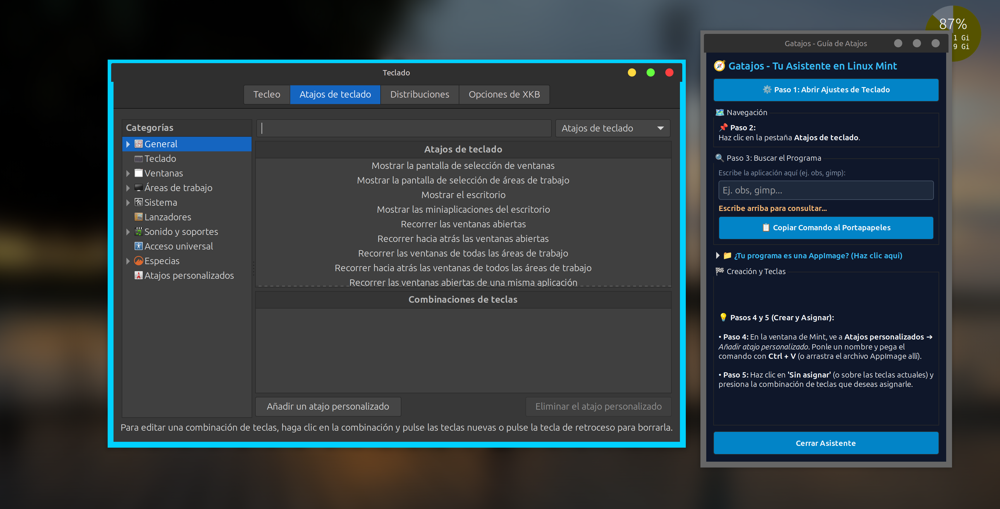

# Gatajos



Gatajos es una utilidad de terminal que consulta los atajos de teclado de Linux Mint Cinnamon. Lee la configuración de GSettings de Cinnamon y muestra la combinación de teclas junto con la acción asociada.

## Qué hace y qué NO hace

### Qué hace

- Consulta los atajos de teclado definidos en la configuración de Cinnamon.
- Muestra cada combinación de teclas con su acción.
- Permite buscar por tecla y listar los atajos disponibles.
- Muestra los comandos asociados a los atajos personalizados con `--mostrar-comandos` solo junto a `--listar` o `--buscar`.

### Qué NO hace

- No asigna ni modifica atajos de teclado.
- No abre el panel de ajustes del sistema.
- No copia información al portapapeles.
- No incluye atajos de aplicaciones de terceros, como OBS.

## Instalación

Descarga el paquete `gatajos_1.0-4_all.deb` desde la sección de releases del repositorio e instálalo con:

```sh
sudo apt install ./gatajos_1.0-4_all.deb
```

El paquete instala dos comandos equivalentes: `gatajos` y `buscar-atajo`.

## Construcción

Para generar el paquete desde el código fuente:

```sh
./build.sh
```

El resultado se guarda en `dist/gatajos_1.0-4_all.deb`. La construcción fija `SOURCE_DATE_EPOCH` a partir de `debian/changelog` y falla si `lintian` encuentra advertencias.

## Uso

```sh
gatajos
gatajos f9
gatajos "alt+c"
gatajos --listar
gatajos --buscar f9
gatajos --listar --mostrar-comandos
gatajos --buscar f9 --mostrar-comandos
gatajos --ayuda
```

También puedes usar `buscar-atajo` con los mismos argumentos. No se pueden combinar modos: usa solo una de las formas `TECLA`, `--buscar TECLA` o `--listar`. `--mostrar-comandos` puede revelar información sensible, por eso solo se admite con `--listar` o `--buscar`.

## Códigos de salida

- `0`: la operación terminó correctamente.
- `1`: error de uso, de entorno o de validación de la tecla.
- `3`: no hubo coincidencias para la tecla solicitada.

## Nombres de comando

- `gatajos`: comando principal.
- `buscar-atajo`: enlace simbólico a `gatajos`.

## Requisitos

- Linux Mint con entorno de escritorio Cinnamon.
- `bash`, `libglib2.0-bin`, `dconf-gsettings-backend` y `cinnamon-desktop-data`.

## Limitaciones

- Solo consulta los atajos que Cinnamon guarda en GSettings.
- No cubre atajos internos de aplicaciones externas, incluido OBS.
- No modifica la configuración del sistema.
- Requiere un entorno Cinnamon instalado para obtener resultados útiles.

## Resolución de problemas

- Si no aparece ningún atajo, comprueba que estás en Linux Mint con Cinnamon.
- Si el comando no se encuentra, verifica que el paquete esté instalado con `dpkg -l gatajos`.
- Para comprobar la versión instalada, ejecuta `gatajos --version`.
- Para ver la ayuda, ejecuta `gatajos --help`.
- Si el paquete es de una versión anterior, reinstala el archivo `.deb` de la release 1.0-4.

## Contribuciones

- Reportes y solicitudes: https://github.com/abuelazotech/Gatajos/issues
- Repositorio: https://github.com/abuelazotech/Gatajos

## Licencia

Gatajos se distribuye bajo la licencia MIT. Consulta el archivo [LICENSE](LICENSE) para el texto completo.
